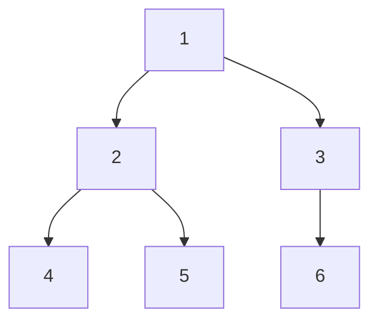

# 数据结构-二叉树

> [!note] 阅读方式
> 二叉树是数据结构核心（教材第 5 章），性质和遍历是重中之重。先懂性质，再背遍历代码。

## 二叉树的性质（必考）

### 逻辑

二叉树：每个节点最多两个子节点（左、右），且左右有序。

几个必须记住的性质（设节点总数为 n，深度为 h，叶子数为 n₀，度为 2 的节点数为 n₂）：

1. 第 i 层最多有 `2^(i-1)` 个节点（i ≥ 1）。
2. 深度为 h 的二叉树最多有 `2^h - 1` 个节点。
3. **`n₀ = n₂ + 1`**（叶子数 = 度为 2 的节点数 + 1），最常考。
4. n 个节点的完全二叉树深度为 `⌊log₂n⌋ + 1`。

**易错点**：
- 性质 3 `n₀ = n₂ + 1` 是核心，记住推导：`n = n₀ + n₁ + n₂`，且 `n = 0·n₀ + 1·n₁ + 2·n₂ + 1`（边数+1）。
- **满二叉树**（每层都满）和**完全二叉树**（只有最后一层可不满且靠左）是两个概念，别混。

**来源**：教材 5.4.1 二叉树的性质。

## 二叉树的存储结构

> [!example]+ 最常用写法
> ```cpp
> struct TreeNode {
>     int val;
>     TreeNode* left;
>     TreeNode* right;
>     TreeNode(int x) : val(x), left(nullptr), right(nullptr) {}
> };
> ```

**用途**：链式存储（左右指针），最常用。还有**顺序存储**（数组存完全二叉树，下标 i 的左右子为 2i、2i+1）。

**易错点**：
- 顺序存储用数组下标 `2i`、`2i+1` 找左右子，**只适合完全二叉树**，普通二叉树会浪费空间。
- 链式存储的节点要 `new` 出来，用 `nullptr` 表示空。

**来源**：教材 5.4.2。

## 二叉树的遍历（重中之重）

### 逻辑

三种深度优先遍历，区别在"访问根节点"的顺序：

- **前序**（根左右）：根 → 左子树 → 右子树
- **中序**（左根右）：左子树 → 根 → 右子树
- **后序**（左右根）：左子树 → 右子树 → 根

记忆口诀：**"前中后"指的是根的位置**。

拿下面这棵树看三种遍历的结果：



- 前序（根左右）：`1 2 4 5 3 6`
- 中序（左根右）：`4 2 5 1 3 6`
- 后序（左右根）：`4 5 2 6 3 1`

**看规律**：前序根在最前、中序根在中间、后序根在最后——"前中后"说的就是根的位置。

### C++ 实现（递归）

```cpp
void preorder(TreeNode* root) {       // 前序
    if (!root) return;
    cout << root->val << " ";         // 根
    preorder(root->left);             // 左
    preorder(root->right);            // 右
}

void inorder(TreeNode* root) {        // 中序
    if (!root) return;
    inorder(root->left);
    cout << root->val << " ";         // 根在中间
    inorder(root->right);
}

void postorder(TreeNode* root) {      // 后序
    if (!root) return;
    postorder(root->left);
    postorder(root->right);
    cout << root->val << " ";         // 根最后
}
```

### 层序遍历（广度优先，用队列）

```cpp
void levelOrder(TreeNode* root) {
    queue<TreeNode*> q;
    q.push(root);
    while (!q.empty()) {
        TreeNode* p = q.front(); q.pop();
        if (!p) continue;
        cout << p->val << " ";
        q.push(p->left);
        q.push(p->right);
    }
}
```

**易错点**：
- 三种遍历的差别**只在 `cout`（访问根）的位置**，左右子递归顺序固定。
- 层序遍历用**队列**，不是栈。
- 已知前序+中序（或中序+后序）能唯一确定二叉树；**只有前序+后序不能**。

**来源**：教材 5.5.1 遍历二叉树。

## 相关链接

- [[数据结构-栈与递归]]
- [[数据结构-队列]]
- [[数据结构-哈夫曼树]]
- [[数据结构-线索二叉树]]
- [[数据结构-二叉排序树与平衡树]]
- [[数据结构-红黑树]]
