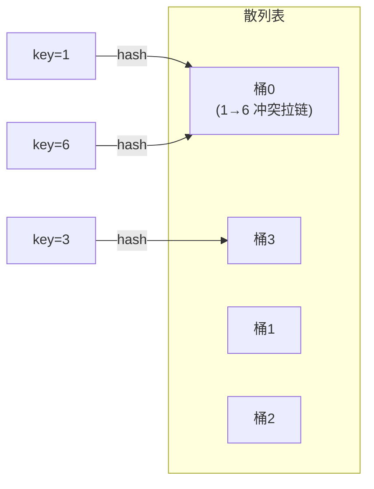

# 数据结构-散列表

> [!note] 阅读方式
> 散列表（哈希表）是查找的终极利器（教材 7.4），平均 O(1)。重点是散列函数和冲突处理。

## 散列表的概念

### 逻辑

散列表（Hash Table）用**散列函数**把关键字直接映射到存储位置，理想情况 O(1) 查找，比有序表的 O(log n) 更快。

核心公式：`存储位置 = hash(key)`。



两个核心问题：
1. **散列函数怎么设计**（尽量均匀分布）。
2. **冲突怎么处理**（不同 key 映射到同一位置，如上图 1 和 6 都落到桶 0）。

### 易错点（逻辑层面）

- 散列表**牺牲空间换时间**，通常要预留多余空间。
- 冲突几乎不可避免（key 无限、位置有限），关键是处理得好。

**来源**：教材 7.4.1。

## 散列函数

### 逻辑

常见散列函数：

| 方法 | 公式 | 特点 |
|---|---|---|
| 除留余数法 | `hash(k) = k mod p` | 最常用，p 取素数 |
| 直接定址法 | `hash(k) = k` 或 `k+c` | 简单，适合连续 key |
| 数字分析法 | 取 key 某几位 | 适合 key 有规律 |

**易错点**：除留余数法的模 p 通常取**不大于表长的素数**，减少冲突。

**来源**：教材 7.4.2。

## 处理冲突

### 逻辑

两种主流方法：

1. **开放定址法**：冲突了就按某种规则找下一个空位。
   - 线性探测：`(hash + i) mod m`，i=1,2,3...
   - 二次探测：`(hash + i²) mod m`。
2. **拉链法（链地址法）**：每个位置挂一个链表，冲突的 key 都放进去。

### C++ 实现（拉链法）

```cpp
// 拉链法：每个桶一个链表
vector<list<pair<int,int>>> table;   // 或直接用 unordered_map

// 实际开发直接用标准库
#include <unordered_map>
unordered_map<int, int> m;
m[1] = 10;          // 插入
m.find(1);          // 查找，返回迭代器
m.count(1);         // 是否存在
```

**易错点**：
- **开放定址法**要处理"删除"（不能直接删，要标记删除），否则查找会断。
- **拉链法**删除简单（从链表删），但多指针开销。
- 装填因子（已存元素/表长）过高时性能下降，要扩容。

**来源**：教材 7.4.3、7.4.4。

## 开发中的使用

> [!example]+ 最常用写法
> ```cpp
> #include <unordered_map>
> #include <unordered_set>
>
> unordered_map<string, int> m;   // 哈希表，无序，O(1) 平均
> unordered_set<int> s;
> ```

**用途**：需要 O(1) 查找/去重时用 `unordered_map`/`unordered_set`；需要有序遍历才用 `map`/`set`（红黑树）。

**易错点**：`unordered_map`（哈希，无序）和 `map`（红黑树，有序）别混，见 [[Cpp-STL常用容器]]。

**来源**：cppreference · unordered_map（https://en.cppreference.com/w/cpp/container/unordered_map ），2026-10-25 访问。

## 相关链接

- [[数据结构-查找算法]]
- [[数据结构-红黑树]]
- [[Cpp-STL常用容器]]
- [[Python-字典与集合]]
- [[Java-集合框架]]
