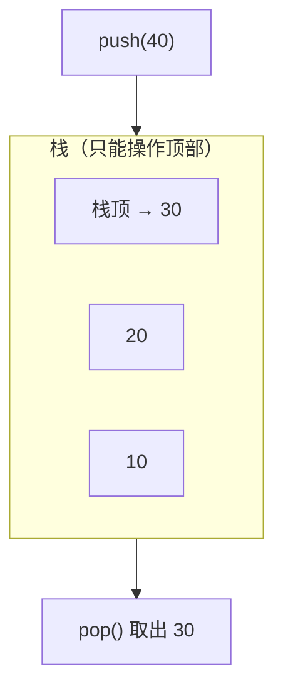

# 数据结构-栈

> [!note] 阅读方式
> 栈是最简单也最常用的结构，逻辑一句话就能说清，重点是理解"后进先出"和几个经典应用。

## 栈的核心思想

### 逻辑

栈（stack）是**后进先出（LIFO，Last In First Out）**的线性结构：只能在一端（栈顶）插入和删除。

就像一摞盘子：最后放上去的，最先拿下来。



两个核心操作：
- **push（入栈）**：在栈顶放一个元素。
- **pop（出栈）**：从栈顶拿走一个元素。

约束：**只能操作栈顶**，不能随意访问中间元素。

### 易错点（逻辑层面）

- 栈只暴露栈顶，中间元素看不到，这既是限制也是特性（保证操作顺序）。
- `top()` 只"看"栈顶不删除，`pop()` 才真正移除，两者常配套使用。

## 用 STL 的 stack

```cpp
#include <iostream>
#include <stack>
using namespace std;

int main() {
    stack<int> s;
    s.push(10);       // 入栈
    s.push(20);
    s.push(30);

    cout << s.top() << "\n";   // 30，栈顶，不删除
    s.pop();                   // 弹出栈顶 30
    cout << s.top() << "\n";   // 20
    cout << s.size() << "\n";  // 2
    cout << s.empty() << "\n"; // 0（false，非空）
    return 0;
}
```

**易错点**：
- `pop()` 返回 `void`，**不返回**被删的值；想拿栈顶值先用 `top()` 再 `pop()`。
- 空栈调用 `top()`/`pop()` 是未定义行为，先判 `empty()`。

**来源**：cppreference · std::stack（https://en.cppreference.com/w/cpp/container/stack ），2026-10-25 访问。

## 经典应用：括号匹配

### 逻辑

判断一串括号 `( ) [ ] { }` 是否配对：

1. 遇到**左括号**就入栈。
2. 遇到**右括号**就检查栈顶：
   - 栈空 → 不匹配（多了右括号）。
   - 栈顶是配对左括号 → 弹出。
   - 栈顶不是 → 不匹配。
3. 最后栈空 → 完全匹配；栈不空 → 多了左括号。

### C++ 实现

```cpp
#include <iostream>
#include <stack>
#include <string>
using namespace std;

bool isValid(string s) {
    stack<char> st;
    for (char c : s) {
        if (c == '(' || c == '[' || c == '{') {
            st.push(c);                       // 左括号入栈
        } else {
            if (st.empty()) return false;     // 右括号多了
            char top = st.top();
            if ((c == ')' && top == '(') ||
                (c == ']' && top == '[') ||
                (c == '}' && top == '{')) {
                st.pop();                     // 匹配，弹出
            } else {
                return false;                 // 不匹配
            }
        }
    }
    return st.empty();   // 栈空才完全匹配
}

int main() {
    cout << isValid("()[]{}") << "\n";   // 1（true）
    cout << isValid("([)]") << "\n";     // 0（false）
    return 0;
}
```

**用途**：括号匹配是栈最典型的应用，也是理解 LIFO 的最佳例子。

## 相关链接

- [[数据结构-链表]]
- [[数据结构-队列]]
- [[Cpp-STL常用容器]]
- [[数据结构-栈与递归]]
