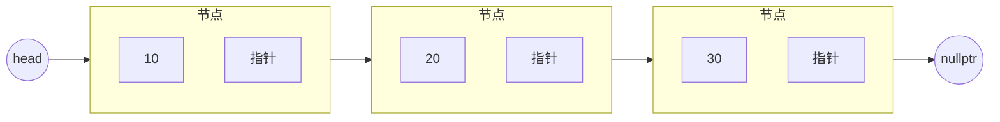
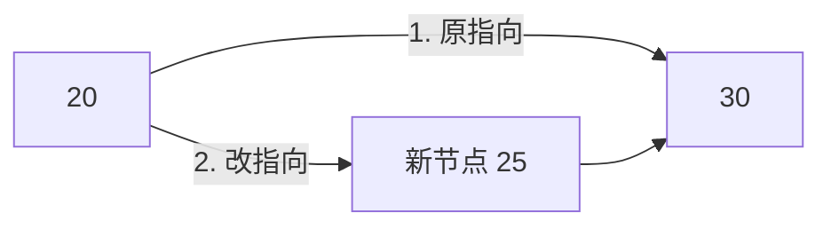

# 数据结构-链表

> [!note] 阅读方式
> 链表是「逻辑」和「代码」最容易脱节的结构，务必先看逻辑图，再对照代码。

## 链表的核心思想

### 逻辑

链表用**节点**串起来，每个节点存两样东西：**数据 + 指向下一个节点的指针**。



和数组的本质区别：

| | 数组 | 链表 |
|---|---|---|
| 存储 | 连续内存 | 节点分散，靠指针连接 |
| 随机访问 a[i] | O(1) | O(n)，要从头走 |
| 中间插入/删除 | O(n)，要挪元素 | O(1)，改指针即可（前提：已定位到位置） |
| 内存 | 一次分配 | 逐个 new，有额外指针开销 |

一句话：**"链表牺牲随机访问，换取中间插入删除的 O(1)"**。

为什么删除是 O(1)？因为不用挪动后面的元素，只要把前一个节点的指针"跳过"被删节点即可。但注意：**要找到被删节点本身仍要 O(n) 遍历**。

### 易错点（逻辑层面）

- 链表没有下标，想访问第 k 个必须从头走 k 步。
- 空链表 `head == nullptr`，很多 bug 来自没处理这个边界。
- 用「哨兵节点」（dummy head）能统一"删头节点"和"删中间节点"的处理，见下文。

## 单链表的 C++ 实现

### 节点定义

```cpp
struct Node {
    int val;
    Node* next;
    Node(int v) : val(v), next(nullptr) {}   // 构造：新建节点 next 置空
};
```

### 建链表（头插法）

```cpp
#include <iostream>
using namespace std;

int main() {
    Node* head = nullptr;
    // 头插：新节点总插在最前面
    for (int v : {30, 20, 10}) {
        Node* p = new Node(v);
        p->next = head;      // 新节点指向原来的头
        head = p;            // 新节点成为新的头
    }
    // 结果：10 -> 20 -> 30（注意头插会反转顺序）

    for (Node* p = head; p != nullptr; p = p->next) {
        cout << p->val << " ";
    }
    return 0;
}
```

### 插入（在某个节点后插入）

插入就是**改两根指针**：新节点先接上后继，前驱再接上新节点。



```cpp
// 在节点 prev 后面插入值 v
void insertAfter(Node* prev, int v) {
    Node* p = new Node(v);
    p->next = prev->next;   // 先让新节点接上后继
    prev->next = p;         // 再让前驱指向新节点（顺序不能反）
}
```

**易错点**：这两行顺序**不能交换**——先改 `prev->next` 会丢失原来的后继。

### 删除（删除某节点的后继）

```cpp
// 删除 prev 的后继节点
void deleteAfter(Node* prev) {
    if (prev->next == nullptr) return;   // 没有后继，什么都不做
    Node* tmp = prev->next;
    prev->next = tmp->next;   // 跳过被删节点
    delete tmp;               // 释放内存
}
```

### 哨兵节点：统一头节点处理

```cpp
// 用哨兵节点，删头节点和删中间节点逻辑统一
Node* dummy = new Node(0);   // 哨兵，不存数据
dummy->next = head;          // 哨兵指向真正的头

// 删除值等于 v 的第一个节点
Node* p = dummy;
while (p->next != nullptr && p->next->val != v) {
    p = p->next;
}
if (p->next != nullptr) {    // 找到了
    Node* tmp = p->next;
    p->next = tmp->next;
    delete tmp;
}
head = dummy->next;          // 真正的头可能变了
```

**用途**：哨兵让"删除头节点"不再需要特殊判断，代码更简洁、少 bug。

## 完整可运行示例

```cpp
#include <iostream>
using namespace std;

struct Node {
    int val;
    Node* next;
    Node(int v) : val(v), next(nullptr) {}
};

void print(Node* head) {
    for (Node* p = head; p; p = p->next)
        cout << p->val << " ";
    cout << "\n";
}

int main() {
    Node* head = new Node(10);
    head->next = new Node(20);
    head->next->next = new Node(30);
    print(head);   // 10 20 30

    // 在 20 后面插 25
    Node* p = head;
    while (p->val != 20) p = p->next;
    Node* q = new Node(25);
    q->next = p->next;
    p->next = q;
    print(head);   // 10 20 25 30
    return 0;
}
```

**易错点汇总**：
- 遍历用 `p != nullptr`（或 `p`）作条件，别用 `p->next` 判断，否则漏掉最后一个节点。
- 手动 `new` 的节点要记得 `delete`，否则内存泄漏。
- 头插会**反转**插入顺序，尾插才保持原序。

**来源**：cppreference · 链表概念见 STL std::list（https://en.cppreference.com/w/cpp/container/list ），手写实现为通用教材知识，2026-10-25 访问。

## 相关链接

- [[数据结构-数组与动态数组]]
- [[数据结构-栈]]
- [[Cpp-基础语法]]
